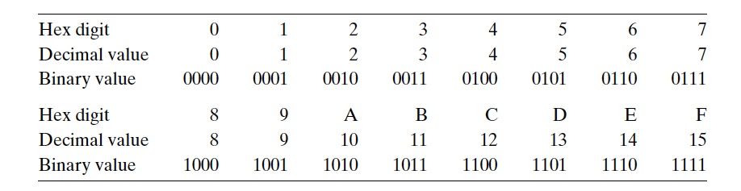
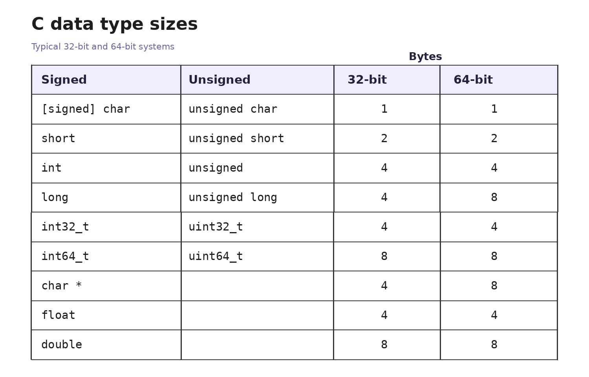
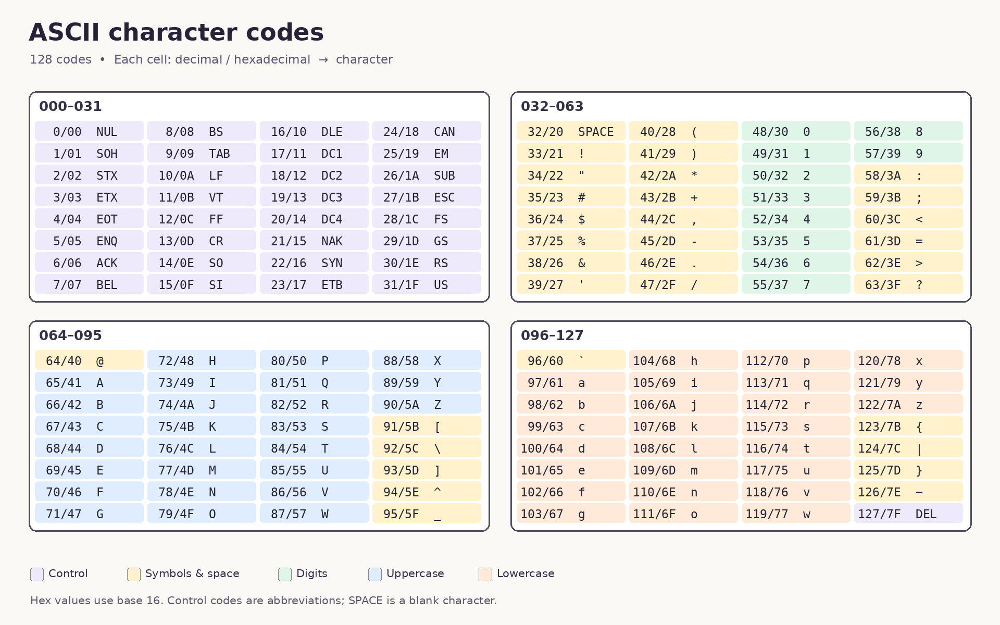

## Hexadecimal Notation

## C declaration of data size

## ASCII vs UTF-8
UTF- Unicode Transformation Format. 

We can think of UTF-8 as an extension of ASCII. ASCII is a subset of UTF-8. It keeps the same codes for all 128 ASCII characters and adds a way to represent characters from many other languages, as well as symbols and emoji.

| | ASCII | UTF-8 |
|---|---|---|
| Characters | 128: English letters, digits, punctuation, and control characters | Can represent characters from many languages and symbol sets |
| Storage | Each ASCII code fits in 7 bits; commonly stored in 1 byte | Uses **1 to 4 bytes** per character |
| Example: `A` | `01000001` | `01000001` — exactly the same byte |
| Example: `é` | Not available | `11000011 10101001` — 2 bytes |

Unicode gives a character its number. UTF-8 tells the computer how to represent that number as bytes.

